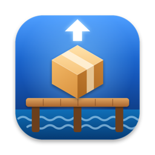
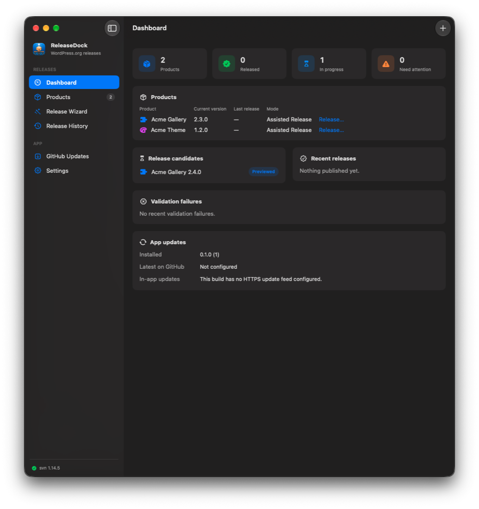
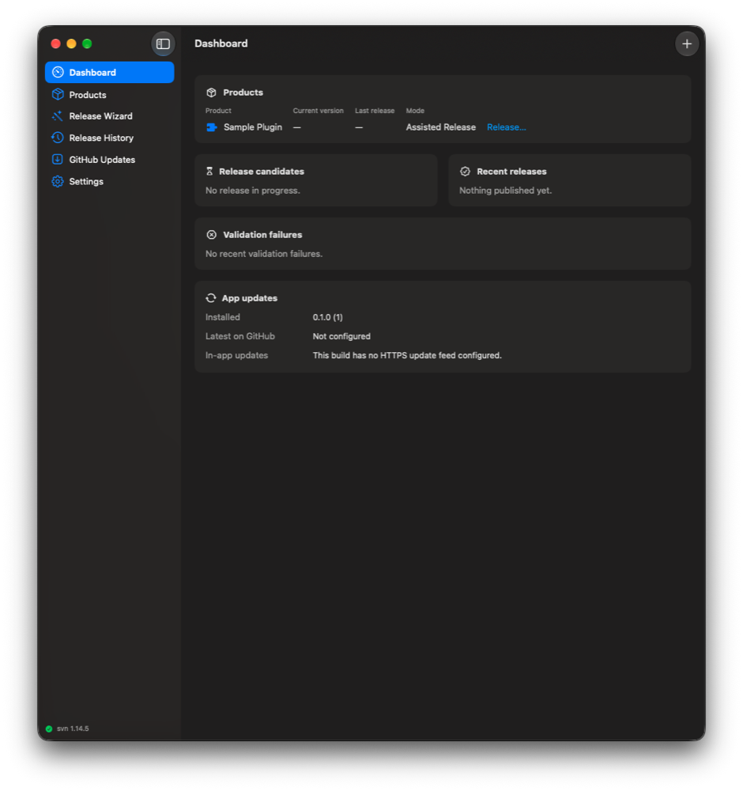
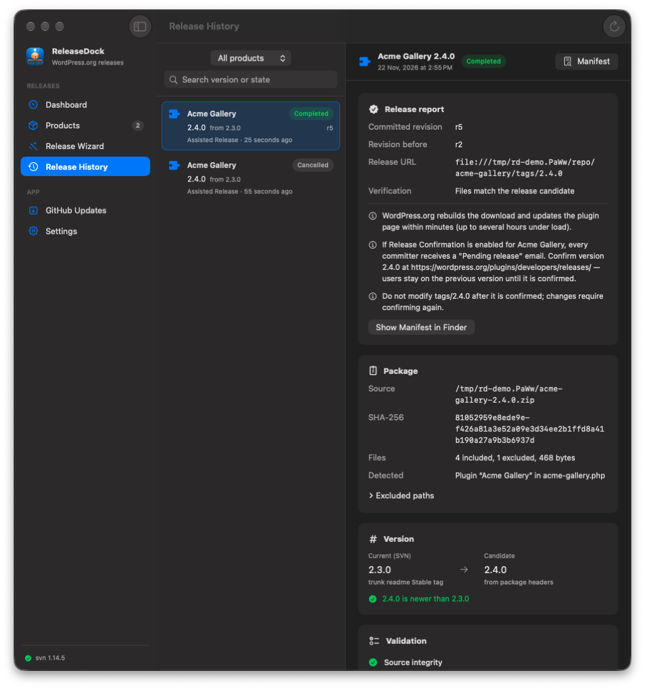

<p align="center">
  
</p>

<h1 align="center">ReleaseDock</h1>

<p align="center">
  <strong>WordPress Plugin &amp; Theme Release Manager for macOS</strong><br>
  Publish a ZIP or a source folder to WordPress.org SVN — inspected, validated, previewed, committed once, and verified.
</p>

<p align="center">
  
  
  
  
  
</p>

---

## Why ReleaseDock?

Releasing to WordPress.org means juggling `svn` commands, keeping `trunk`, `tags` and the readme's `Stable tag` in sync, keeping `.git`, `node_modules` and `.DS_Store` out of the release, and hoping nothing times out halfway through. A mistake ships to every site that updates.

ReleaseDock is a native macOS app that does the whole release for you. It checks everything first, shows you exactly what will change in SVN, then commits once. It never guesses: if anything is unclear, it stops and asks.

<p align="center">
  
</p>

## Features

**Release from anything**
- Drop a ZIP, pick a folder, or use *Open With → ReleaseDock* in Finder.
- Releasing only ever reads the source. ReleaseDock builds and publishes a cleaned copy. The one exception is **Bump Version…**, which edits your development folder after you approve each line it changes.

**Safe package inspection**
- A built-in ZIP reader blocks path traversal, symlinks, duplicate and case-conflicting paths, nested folders, encrypted entries and zip bombs.
- OS junk (`.DS_Store`, `__MACOSX`), VCS folders (`.git`, `.svn`) and dev artifacts (`node_modules`, lock files, CI configs) are excluded automatically. `.distignore` and your own patterns are honoured.
- Archives, binaries and likely secrets (`.env`, private keys, `wp-config.php`) are flagged.

**Versions WordPress agrees with**
- The version is read from the main plugin file or `style.css`, exactly as WordPress core's `get_file_data()` reads it. File names are never used.
- Versions are compared with a port of PHP's `version_compare()`, tested against real PHP on 1,024 version pairs.
- Same, older or ambiguous versions are blocked. So is a tag that already exists.

**20 validation checks**
- 15 required checks: product identity, version, `Stable tag`, readme, required and forbidden files, SVN connectivity, working-copy cleanliness and freshness, existing tag, released version (readme updates), credentials, and the release diff.
- 5 optional checks: changelog entry, *Tested up to* (compared with the current WordPress release), package size, clean Git tree and portable file names.
- Each check reports a severity, the file involved and a suggested fix.

**Exact preview, single commit, verified result**
- **Plugins:** `trunk` is updated and `svn cp trunk tags/<version>` is added. The `/assets` folder (banners, icons, screenshots) can be synced, with correct MIME types.
- **Readme & Assets Update (plugins):** raise *Tested up to* or fix the readme without a new version. The readme is updated in `trunk` and in the released tag in one commit; a package whose code differs from the released tag is refused.
- **Restore an older version:** when a release breaks sites, **Products → Restore Older Version…** exports an earlier version from SVN, gives it a new, higher version with a changelog entry, and runs it through the normal checks and review. WordPress.org never moves backwards, so sites on the broken version update to the restored code; released tags are never changed.
- **Themes:** the previous version directory is copied to `/<version>/`, as the Themes handbook describes.
- **Preview:** you see every SVN change and the full diff before anything is committed. Your approval covers exactly that preview; if the working copy changes, you have to approve again.
- **Verification:** after the commit, ReleaseDock checks the server copy file by file (SHA-256) and records the revision in a release manifest.

**Built for the bad day**
- If a commit times out, crashes or loses its connection, ReleaseDock never retries blindly. It looks up the release's unique ID in the SVN log and continues from what actually happened.
- If the app quits mid-release, it recovers cleanly on the next launch.
- A working copy with local changes is never touched without your say-so. Reverting is an explicit action that backs everything up first.

**Three release modes**
- **Dry Run:** does everything except commit.
- **Assisted** (default): stops at the preview and asks for your confirmation.
- **Automatic:** you must enable it for each product. It publishes on its own only if every safety condition holds.

**Secure by default**
- Your SVN password is stored only in the macOS Keychain and passed to `svn` through stdin. It never appears on the command line, in svn's own cache, in logs or in manifests.
- No shell is ever involved.

**Stays up to date**
- Checks GitHub for new ReleaseDock releases and notifies you.
- Installs updates through Sparkle 2, but only if they carry valid EdDSA and Developer ID signatures.

<p align="center">
  
</p>

<p align="center">
  
</p>

## Requirements

- macOS 14 Sonoma or later
- Subversion 1.10 or later. Apple no longer ships `svn`; install it with:
  ```bash
  brew install subversion
  ```
- A WordPress.org account with commit access to your plugin or theme, plus an **SVN password**. Create it under *Profile → Account & Security → SVN credentials*.

## Installation

Download the latest `ReleaseDock-<version>.zip` from **[github.com/mahbubur001/releasedock/releases](https://github.com/mahbubur001/releasedock/releases)**, unzip it and move **ReleaseDock.app** to `/Applications`.

- **First launch:** current builds are not yet notarized by Apple, so macOS may say it can't verify the developer. Open **System Settings → Privacy & Security** and click **Open Anyway** next to the ReleaseDock message. You only need to do this once.
- **Updates:** when a new version is out, **Update found** and an **Update** button appear at the top right of the toolbar (or use **ReleaseDock → Check for Updates…**). The update window shows what's new; **Install & Relaunch** downloads the new version, verifies its EdDSA signature against the key built into the app, installs it and relaunches.
- **Publishing a new version** (maintainers): the **Release** GitHub Actions workflow (release notes come from the version's CHANGELOG.md section) — see [RELEASE_WORKFLOW.md](RELEASE_WORKFLOW.md).

To build it yourself, see [Building from source](#building-from-source). To install your own build on this Mac, run `scripts/install-local.sh`.

## Getting started

### 1. Add a product

Open **Products** and click **+**. There are three ways to add one:

- **Check out from SVN server.** Pick Plugin or Theme and type the slug (for example `my-plugin`) or the full SVN URL, then click **Find**. ReleaseDock reads the repository and shows the product name, type, current version and number of tags. **Check Out & Add** then downloads a lightweight copy: trunk and the tag list for plugins, or the latest version folder for themes.
- **Use an existing working copy.** Choose a folder you already checked out with `svn`; it must be the product root, the folder that contains `trunk/`. ReleaseDock reads the repository URL from it and warns you if the folder has local changes.
- **Set up manually.** Fill in every field yourself.

You never type the name, slug, type or current version. They are read from SVN and from the plugin or theme headers. To finish:

1. Optionally enter your **WordPress.org username** (case-sensitive) and **SVN password**. The password is stored only in the Keychain. If `svn` already has a cached WordPress.org login, you can skip this.
2. Optionally edit the product to add a development folder, an assets folder, exclusion patterns, a GitHub repository or validation options.

### 2. Release

Open **Release Wizard**, choose the product, and drop in your ZIP or folder. Then click **Inspect & Prepare**. The wizard runs through nine steps:

| Step | What happens |
|---|---|
| Select | Pick the product, the package and the release mode |
| Inspect | Safety checks, exclusions and SHA-256 of the source |
| Compare | Candidate version against the version currently on SVN |
| Validate | All checks; anything blocking stops the release here |
| Stage | Clean copy built and applied to the SVN working copy |
| Preview | Every SVN change, the diff and the commit message |
| Approve | Your confirmation, or the automation gate in Automatic mode |
| Publish | One atomic `svn commit` |
| Verify | Server copy compared with the candidate; revision recorded |

When it finishes, the release report shows the committed revision, the release URL, the verification results and any follow-up steps. For example, if your plugin uses WordPress.org **Release Confirmation**, you still have to confirm the release by email.

### 3. Review history

**Release History** lists every attempt, with its full timeline, validation report, SVN changes and manifest. A release that needs recovery also appears here, together with the actions available for it.

## How it works

```
 ZIP / folder ──► Inspect ──► Detect version ──► Snapshot SVN ──► Validate
                                                                     │
           Verify ◄── Commit ◄── Approve ◄── Preview ◄── Stage ◄─────┘
             │
             └──► Manifest · History · Notification
```

- All release logic lives in **ReleaseDockCore**, a Swift package with no UI code and 210 tests.
- Integration tests run the real `svn` binary against local repositories laid out like WordPress.org.
- The SwiftUI app is a thin layer on top of the package.

See [ARCHITECTURE.md](ARCHITECTURE.md) for the services, the state machine and the data layout. See [RELEASE_WORKFLOW.md](RELEASE_WORKFLOW.md) for the exact SVN steps and how failures are handled.

## Where your data lives

```
~/Library/Application Support/ReleaseDock/ReleaseDockData/
├── Products/   SVN working copies managed by ReleaseDock
├── Staging/    temporary per-release workspaces (cleaned up automatically)
├── Releases/   release manifests (JSON)
├── Backups/    working-copy backups and database backups
├── Logs/       diagnostic exports
└── Database/   SQLite database
```

Credentials are never stored here; they are kept only in the macOS Keychain. **Settings → General → Diagnostics → Export…** writes a support bundle with secrets redacted.

## Troubleshooting

| Problem | What to do |
|---|---|
| "svn unavailable" in the sidebar | `brew install subversion`, or set the path to `svn` in **Settings**. |
| Authentication failed | Use your WordPress.org **username**, not your email address, and the **SVN password** from your profile. Nothing was committed; enter the credentials and approve again. |
| Working copy has local changes | Commit or revert them yourself, or use **Products → Revert Working Copy…**, which copies every changed file to `Backups/` first. |
| Version is not newer / tag already exists | Released versions are permanent. Raise the version in your plugin header (and in `Stable tag`) and try again. |
| Release shows *Recovery Required* | Click **Inspect Repository**. ReleaseDock checks whether the commit landed and either completes the release or tells you it's safe to publish again. |
| Theme release blocked: no released version | A theme's first version must go through [wordpress.org/themes/upload](https://wordpress.org/themes/upload/). |
| Plugin page still shows the old version | WordPress.org can take a few minutes, or several hours under load, to rebuild. Check for a Release Confirmation email. |

## Building from source

```bash
brew install subversion xcodegen
git clone <this repository> && cd releasedock
scripts/test.sh             # runs the tests and builds the app
open ReleaseDock.xcodeproj  # run the "ReleaseDock" scheme
```

- **Requirements:** Xcode 16 or later. The project is generated from `project.yml` with XcodeGen.
- **Configuration and conventions:** see [DEVELOPMENT.md](DEVELOPMENT.md).
- **Signing and releasing:** see [RELEASE_WORKFLOW.md](RELEASE_WORKFLOW.md) (Developer ID, notarization and the Sparkle appcast).

## Documentation

| Document | Contents |
|---|---|
| [ARCHITECTURE.md](ARCHITECTURE.md) | Modules, services, state machine, persistence |
| [RELEASE_WORKFLOW.md](RELEASE_WORKFLOW.md) | Plugin and theme release steps, recovery, shipping ReleaseDock |
| [SECURITY.md](SECURITY.md) | Threat model, credential handling, update verification |
| [TESTING.md](TESTING.md) | Test strategy and the failure scenarios covered |
| [DEVELOPMENT.md](DEVELOPMENT.md) | Building, configuration, conventions |
| [IMPLEMENTATION_PLAN.md](IMPLEMENTATION_PLAN.md) | Phase status and remaining work |
| [CHANGELOG.md](CHANGELOG.md) | Release notes |
| [docs/research/](docs/research/) | Sourced research on WordPress.org SVN, Sparkle, the GitHub API and macOS security |

## Project status

All implementation phases are complete and tested locally against real `svn` and local repositories. Two things haven't been exercised yet, because they need the publisher's own accounts:

- a release to the live WordPress.org servers
- Developer ID signing, notarization and Sparkle updates of ReleaseDock itself

Details are in [IMPLEMENTATION_PLAN.md](IMPLEMENTATION_PLAN.md).

## Security

See [SECURITY.md](SECURITY.md). Please report vulnerabilities privately through GitHub Security Advisories rather than in public issues.

## Disclaimer

ReleaseDock is an independent tool. It is not affiliated with or endorsed by WordPress.org or the WordPress Foundation. "WordPress" is a trademark of the WordPress Foundation.

## Contributing

Bug reports, feature requests and pull requests are welcome. See [CONTRIBUTING.md](CONTRIBUTING.md); report security issues privately as described in [SECURITY.md](SECURITY.md).

## License

ReleaseDock is released under the [MIT License](LICENSE).
